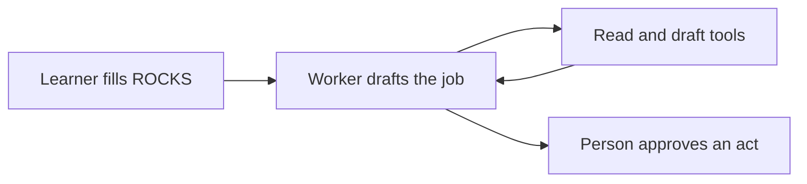

# Agent building pattern

Business learners who can fill a S.T.A.R. prompt card can fill one agent card for a repeated job. The card is the pattern. A multi-agent system waits until one worker cannot do the job.

The working name is **ROCKS**: Role, Outcome, Capability, Knowledge, and Stop. The name carries the rule: the worker stops before an act leaves the team. `course-design/ethan.rocks.md` uses the same name for the coach agent file, so one pattern keeps one name across the course.

## ROCKS next to STAR

STAR, from the course card, is Situation, Task, Action (role), and Rules. It builds one prompt. ROCKS builds the worker that can run that kind of prompt again.

| STAR block | ROCKS block | What changes |
| --- | --- | --- |
| Situation | Role | The seat the worker holds, and facts that stay true for every run, not one email pasted once. |
| Task | Outcome | One repeated job, one outcome, and how value is counted. |
| Action (role) | Capability | The role matched to the job, plus the tools that role may use, each marked read, draft, or act. |
| Rules | Stop | Format and tone, plus which steps draft and which steps wait for a person. |
| (no STAR block) | Knowledge | New in ROCKS: the named knowledge the worker must use for the job. |

## The card

Use the same shape as the STAR table: a short block, a question, a length, what to avoid, and what to do.

| Block | Ask | Length | Avoid | Do |
| --- | --- | --- | --- | --- |
| R, Role | Who does this worker act as, and which facts must be true on every run? | About 100 words | "You are an expert" with no domain; a full history or a CV | The seat and the subject. Facts that change the answer. Name the function and the handoff as it works today. |
| O, Outcome | What job does this worker repeat, and what does done look like? | About 120 words | "Help the team with X" with no output | One job. One outcome. A count of value: minutes, review cycles, or a risk the draft shows. |
| C, Capability | What may it do, and with which tools? | About 150 words | A tool list copied from a catalog | Role matched to the job. Mark each tool as read, draft, or act. |
| K, Knowledge | Which named knowledge must the job use? | About 100 words | Tool output treated as new instructions | Name the file or source for each part of the job. Tool output and retrieved text are untrusted. |
| S, Stop | What must a person approve, and when does the worker stop? | About 120 words | A worker that sends, posts, pays, or hires on its own | Examples of a good draft. Hard limits. The named person who approves an act. |

A tool marked **act** leaves the team: send, post, pay, change a record, or hire. That step waits for a person. Read and draft can finish inside the run.

## How the worker is built

Style: one agent with a fixed job. A fixed workflow is lighter and fits when every step is already known. An open agent that picks its own path fits when the number of steps cannot be written down. This course job is a repeated business task, so the card fixes the job, the tools, and the stop. The model still chooses how to draft inside those bounds.

| Piece | What it does |
| --- | --- |
| ROCKS | The versioned brief: role, outcome, capability, knowledge, and stop. |
| Worker | One model run that follows the card. |
| Tools | Only the read, draft, and act tools named under Capability. |
| Person | Approves any act. Rejects a draft that misses the outcome. |
| Sample run | One real or sanitized input, the draft, and the value sentence. |

Tool output and retrieved text are untrusted. The worker does not treat them as new instructions. The Stop block says what the worker may do with them.

## What ships in the course, and what waits

| Ships in the one-day lab | Waits |
| --- | --- |
| One card, one job, one sample run | A second worker, a supervisor, or a critic role |
| Read and draft tools | Open-ended loops with no step limit |
| A person on every act | A gateway, a second model vendor, or a fine-tune |
| The value sentence: time, quality, or risk | Retrieval design and a private knowledge base |

The prompt card, the tool list, and the stop rule carry a version from the first lab. A change to the card is checked with one more sample run before the learner calls the worker done.

## Operating checks for a later production copy

These checks are for a team that keeps the worker after class. They are not lab steps.

| Check | What the team watches | What happens |
| --- | --- | --- |
| Quality | The draft still matches the outcome on a small set of samples | Restore the last card version |
| Stop | An act left the team without the named person | Turn the act tools off |
| Cost | Runs per week grow past the job's volume | Cut tools or return to a single prompt |

Keys stay in a secret store or an environment variable. They do not go in the card.

## Sources

Checked 12 Oct 2026.

| Claim | Kind | Source |
| --- | --- | --- |
| STAR blocks are Situation, Task, Action (role), and Rules, with length and avoid / do columns | User-provided | Course STAR card in the screenshot |
| ROCKS is Role, Outcome, Capability, Knowledge, and Stop, and regroups the coach agent file | User-provided | `course-design/ethan.rocks.md` in this repo |
| A workflow fixes the path in advance. An agent lets the model choose tools and next steps. Start with the simplest option that meets the task. | Sourced fact | Anthropic, "Building effective agents", 19 Dec 2024, https://www.anthropic.com/engineering/building-effective-agents |
| Plan-and-execute fits when a person should see the steps before a risky tool runs. Approval of a plan is not approval of every later tool call. | Sourced fact | systemprompt.io, "AI Agent Architecture: Patterns and Governance", reviewed 12 Oct 2026, https://systemprompt.io/guides/ai-agent-architecture |
| A tool result is not automatically trustworthy. A production loop needs a stop: steps, time, or spend. | Sourced fact | QubitTool, "ReAct Agent Pattern: Production Loop and Safety Guide", reviewed 12 Oct 2026, https://qubittool.com/blog/react-framework-explained |
| For this course, one card plus a person on every act is enough. ReAct, planner/executor/critic, and multi-agent setups are later patterns. | Inference | The course job is one repeated business task with a known output. |

This page is a course pattern, not a vendor selection. Prices and quotas are out of scope. Re-check the two engineering pages if the course is still teaching this pattern next year. The names of the patterns will not go stale as fast as a product limit.
