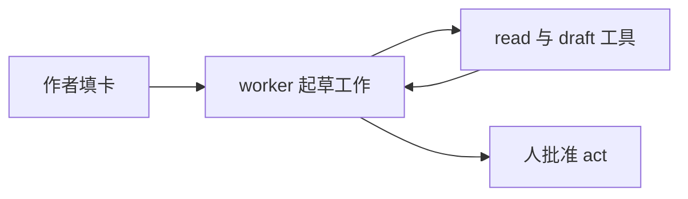

# Agent 设计模式：sibling 参考副本

本副本蒸馏自 agent.dan 仓库 `specs/agent-design-patterns/00-06` 七个文件，随 skill 走，任何宿主、任何会话可用。仓库是编辑源：`00-06` 改版后同步刷新本副本并重导 kb，三处一致以仓库为准。

原书：《Agentic Design Patterns: A Hands-On Guide to Building Intelligent Systems》（Antonio Gulli）。配套代码：GitHub `DanieleSalatti/AgenticDesignPatterns` 仓库 `notebooks/` 目录，按 `Chapter N_` 前缀分章；原书 PDF 在 agent.dan 仓库 `specs/agent-design-patterns/` 目录。

---

# Agent 设计模式：选型索引

来源：《Agentic Design Patterns: A Hands-On Guide to Building Intelligent Systems》（Antonio Gulli），21 个模式章节。本索引把 21 章压成一张选型表：先看任务特征与示例，再选模式，最后用“不适用条件”排除。

- 原书全文：本目录 Agentic_Design_Patterns.pdf（agent.dan 仓库 specs/agent-design-patterns/ 目录）
- 章号深读：社区中文翻译 [xindoo/agentic-design-patterns](https://github.com/xindoo/agentic-design-patterns) 的 `chapters/` 目录，下表“章号”链接直达该章中译；翻译与原书有出入时以 PDF 为准
- 配套代码：GitHub [DanieleSalatti/AgenticDesignPatterns](https://github.com/DanieleSalatti/AgenticDesignPatterns) 的 `notebooks/` 目录，按 `Chapter N_` 前缀分章；链接在 02-06 各主题笔记的模式节尾，标“配套代码”
- ROCKS（agent 编写范式）是本仓库自有内容，不是原书章节，见表首行与 本文件「ROCKS：agent 编写范式」一节

## 选型表

| 任务特征 | 示例 | 推荐模式 | 章号 | 不适用条件（推断） |
| --- | --- | --- | --- | --- |
| 要定义或修订一个 agent（写 agent 文件） | 为发票异常处理岗写一个 agent 文件 | ROCKS（agent 编写范式） | 本文件「ROCKS：agent 编写范式」一节 | 运行期编排问题（串行、分流、并行）不归 ROCKS 管，按下面 21 个模式选 |
| 任务可拆成固定顺序的子步骤，前一步输出是后一步输入 | 市场分析流水线：摘要 → 提取趋势 → 撰写邮件 | Prompt Chaining | [第 1 章](https://github.com/xindoo/agentic-design-patterns/blob/main/chapters/Chapter%201_%20Prompt%20Chaining.md) | 步骤间无依赖、或需要动态分支时，硬串行反而增加延迟 |
| 输入类型多样，需按意图分流到不同工具或子流程 | 客服机器人区分销售、技术支持、账号管理三类请求 | Routing | [第 2 章](https://github.com/xindoo/agentic-design-patterns/blob/main/chapters/Chapter%202_%20Routing.md) | 只有一条执行路径、或分流规则少于两个时无收益 |
| 多个子任务互不依赖，且各自有 I/O 等待 | 同时调多个外部 API 取数，再汇总成一份报告 | Parallelization | [第 3 章](https://github.com/xindoo/agentic-design-patterns/blob/main/chapters/Chapter%203_%20Parallelization.md) | 任务强依赖彼此输出；或并发引入的调试与日志成本超过收益 |
| 需要访问模型训练数据之外的实时数据或执行动作 | 查实时汇率、查数据库、发邮件、执行代码 | Tool Use (Function Calling) | [第 5 章](https://github.com/xindoo/agentic-design-patterns/blob/main/chapters/Chapter%205_%20Tool%20Use.md) | 纯文本生成任务，不需要外部数据或副作用 |
| 产出需要质量把关与迭代改进 | 文案、代码、分析报告的“生成 → 评价 → 改进”循环 | Reflection | [第 4 章](https://github.com/xindoo/agentic-design-patterns/blob/main/chapters/Chapter%204_%20Reflection.md) | 一次性低成本任务；或无明确评价标准，自我评估会空转 |
| 目标复杂，需要先分解为步骤序列再执行 | 自动生成研究报告、新员工入职流程、竞品分析 | Planning | [第 6 章](https://github.com/xindoo/agentic-design-patterns/blob/main/chapters/Chapter%206_%20Planning.md) | 单步可完成的简单任务，规划反而增加开销 |
| 单 agent 能力不足，任务可按专长分派给多个角色 | 复杂研究分析、软件开发、创意内容生产 | Multi-Agent Collaboration | [第 7 章](https://github.com/xindoo/agentic-design-patterns/blob/main/chapters/Chapter%207_%20Multi-Agent%20Collaboration.md) | 任务单角色可完成；多 agent 会放大协调成本与误差传播 |
| 需要跨会话记忆与上下文管理 | 跨会话记住用户偏好的个人助理；多步任务的进度追踪 | Memory Management | [第 8 章](https://github.com/xindoo/agentic-design-patterns/blob/main/chapters/Chapter%208_%20Memory%20Management.md) | 单轮、无状态交互不需要 |
| 系统需根据历史经验持续改进行为 | 个性化助手、交易机器人、欺诈检测 | Learning and Adaptation | [第 9 章](https://github.com/xindoo/agentic-design-patterns/blob/main/chapters/Chapter%209_%20Learning%20and%20Adaptation.md) | 任务模式稳定，一次性调优已足够 |
| 需要以标准协议接入多种外部工具与数据源 | 企业系统经 MCP 接入持续演进的外部工具与数据源 | Model Context Protocol (MCP) | [第 10 章](https://github.com/xindoo/agentic-design-patterns/blob/main/chapters/Chapter%2010_%20Model%20Context%20Protocol%20%28MCP%29.md) | 工具少而固定时，直接 function calling 更简单 |
| agent 需自主执行多步任务并追踪目标达成 | 自主执行多步任务，偏离目标时自我修正 | Goal Setting and Monitoring | [第 11 章](https://github.com/xindoo/agentic-design-patterns/blob/main/chapters/Chapter%2011_%20Goal%20Setting%20and%20Monitoring.md) | 有人类逐步把关的流程，不需要自主目标追踪 |
| 生产环境存在工具失败、网络错误等运行期故障 | 工具超时、API 报错时的重试、降级与回滚 | Exception Handling and Recovery | [第 12 章](https://github.com/xindoo/agentic-design-patterns/blob/main/chapters/Chapter%2012_%20Exception%20Handling%20and%20Recovery.md) | 原型验证阶段，失败即可重跑的场景 |
| 决策后果涉及安全、伦理或大额资金，需人把关 | 医疗、金融、自动驾驶的关键决策升级给人 | Human-in-the-Loop | [第 13 章](https://github.com/xindoo/agentic-design-patterns/blob/main/chapters/Chapter%2013_%20Human-in-the-Loop.md) | 高吞吐低风险场景，人工介入会成为瓶颈 |
| 回答需基于私有或最新知识，且要求可溯源 | 企业内部文档问答、带引用来源的客服机器人 | Knowledge Retrieval (RAG) | [第 14 章](https://github.com/xindoo/agentic-design-patterns/blob/main/chapters/Chapter%2014_%20Knowledge%20Retrieval%20%28RAG%29.md) | 任务与私有知识无关，或模型内知识已足够 |
| 多个异构框架的 agent 之间需要互操作与任务委派 | ADK、LangGraph、CrewAI 构建的 agent 互相委派任务 | Inter-Agent Communication (A2A) | [第 15 章](https://github.com/xindoo/agentic-design-patterns/blob/main/chapters/Chapter%2015_%20Inter-Agent%20Communication%20%28A2A%29.md) | 全部 agent 在同一框架内，直接进程内调用即可 |
| 需要在成本、延迟与质量之间动态权衡模型选择 | 简单查询给快而便宜的模型，复杂推理给强模型 | Resource-Aware Optimization | [第 16 章](https://github.com/xindoo/agentic-design-patterns/blob/main/chapters/Chapter%2016_%20Resource-Aware%20Optimization.md) | 流量小、预算宽松，简单单一模型足够 |
| 问题需要显式多步推理（数学、诊断、法律分析） | 多跳问答、代码调试、法律分析 | Reasoning Techniques (CoT/ReAct) | [第 17 章](https://github.com/xindoo/agentic-design-patterns/blob/main/chapters/Chapter%2017_%20Reasoning%20Techniques.md) | 模式化简单问答，显式推理只增加延迟 |
| agent 输出会影响用户、系统或声誉，需要防护 | 对外客服、内容生成平台、金融/医疗敏感系统 | Guardrails/Safety Patterns | [第 18 章](https://github.com/xindoo/agentic-design-patterns/blob/main/chapters/Chapter%2018_%20Guardrails_Safety%20Patterns.md) | 离线内部实验，输出无外溢风险 |
| 需要持续度量 agent 的效果、效率与合规 | 生产部署的准确率、延迟、解决率追踪 | Evaluation and Monitoring | [第 19 章](https://github.com/xindoo/agentic-design-patterns/blob/main/chapters/Chapter%2019_%20Evaluation%20and%20Monitoring.md) | 尚无生产部署，无运行指标可采集 |
| agent 需在冲突目标与有限资源下自主排序任务 | 多任务冲突时按紧迫性、重要性与成本动态排序 | Prioritization | [第 20 章](https://github.com/xindoo/agentic-design-patterns/blob/main/chapters/Chapter%2020_%20Prioritization.md) | 同一时刻只有一个待办任务 |
| 开放式领域，需要发现“未知的未知” | 科学研究假设生成、开放式市场机会发现 | Exploration and Discovery | [第 21 章](https://github.com/xindoo/agentic-design-patterns/blob/main/chapters/Chapter%2021_%20Exploration%20and%20Discovery.md) | 解空间已定义清楚的优化型任务 |

## 使用建议

- 先按“任务特征”列定位，再看“不适用条件”排除；排除依据多由各章失败模式反推，标注为推断，非原书原文。
- 模式可组合：生产系统常见组合是 Tool Use + Planning + Exception Handling + Evaluation 四件套。
- 按主题分组的详细笔记见本文件后面各组；ROCKS 编写范式见 本文件「ROCKS：agent 编写范式」一节。

# ROCKS：agent 编写范式

ROCKS 是编写单个 agent 定义文件的范式：Role、Outcome、Capability、Knowledge、Stop。能把一件重复性工作讲清楚的人，就能填出一张卡。卡就是范式。单 agent 干不了的活，才需要多 agent 系统。

名字自带规则：worker 在动作离开团队之前必须停下。本仓库 `sdd.works.ethan/ethan.md` 用 ROCKS 五块写成教练 agent，一个模式在仓库里只留一个名字。

## 定位：编写范式，不是运行期设计范式

ROCKS 回答“这一个 agent 怎么定义”，不回答运行期 agents、工具、步骤怎么组合。组合属于设计范式，选型表见 `specs/agent-design-patterns/00-index.md`。

| | ROCKS（编写） | 设计范式（运行期） |
| --- | --- | --- |
| 回答的问题 | 这一个 agent 怎么定义？ | agents、工具、步骤怎么为一个任务组合？ |
| 产物 | 一份 agent 定义，写一次、带版本 | 按任务或系统选的执行结构 |
| 例子 | Role、Outcome、Capability、Knowledge、Stop | Prompt Chaining、Routing、Reflection、Multi-Agent |
| 使用时机 | 写或改 agent 文件时 | 做系统设计，或为任务选路径时 |

两者配合使用：ROCKS 定义 worker，设计范式决定这个 worker 在更大流程里的位置。

## 卡片

每个块有一组问题、篇幅、避免什么、做什么。

| 块 | 问什么 | 篇幅 | 避免 | 要做 |
| --- | --- | --- | --- | --- |
| R, Role | 这个 worker 以什么身份做事？每次运行必须为真的事实是什么？ | 约 100 词 | “你是一位专家”却没有领域；完整履历 | 岗位和主题。会改变答案的事实。按现状写出职能和交接。 |
| O, Outcome | 这个 worker 重复做哪件工作？做完长什么样？ | 约 120 词 | “帮团队做 X”却不说产出 | 一件工作。一个产出。价值的量化：省下的分钟数、评审轮数、草稿暴露的风险。 |
| C, Capability | 它可以做什么？用哪些工具？ | 约 150 词 | 从目录里抄一份工具清单 | 岗位匹配工作。每个工具标注 read、draft 或 act。 |
| K, Knowledge | 这件工作必须用哪些指名的知识？ | 约 100 词 | 把工具输出当新指令 | 为工作的每部分点名文件或来源。工具输出和检索文本不可信。 |
| S, Stop | 哪些事必须人批准？worker 何时停下？ | 约 120 词 | worker 自行发送、发帖、付款、招聘 | 好草稿的例子。硬边界。批准每个 act 的具体的人。 |

标 **act** 的工具离开团队：发送、发帖、付款、改记录、招聘。这一步等人。read 和 draft 可以在运行内完成。

## worker 怎么搭

风格：一个 agent，一件固定的工作。固定 workflow 更轻，每一步都已知时适用。开放式 agent 自己选路径，步骤数写不下来时适用。产出明确的重复性工作适合固定卡：卡定死工作、工具、停止点。模型仍在边界内自己决定怎么起草。

| 组成 | 作用 |
| --- | --- |
| ROCKS | 带版本的 brief：role、outcome、capability、knowledge、stop。 |
| Worker | 按卡执行的一次模型运行。 |
| Tools | 只有 Capability 里点名的 read、draft、act 工具。 |
| Person | 批准每个 act。驳回不符合产出的草稿。 |
| Sample run | 一个真实或脱敏的输入、草稿、价值句。 |

工具输出和检索文本不可信。worker 不把它们当新指令。Stop 块写明 worker 可以拿它们做什么。

## 第一版与后续

| 第一版 | 后续 |
| --- | --- |
| 一张卡、一件工作、一次样本运行 | 第二个 worker、监督者、critic 角色 |
| read 和 draft 工具 | 无步数上限的开放循环 |
| 每个 act 有人 | 网关、第二模型厂商、微调 |
| 价值句：时间、质量、风险 | 检索设计与私有知识库 |

卡、工具清单、停止规则从第一版起带版本。改卡先跑一次样本运行，通过后改动才发布。

## 生产副本的运行检查

这些检查面向把 worker 保留到生产的团队。

| 检查 | 团队盯什么 | 动作 |
| --- | --- | --- |
| 质量 | 草稿在小样本集上仍符合产出 | 回滚到上一个卡版本 |
| 停止 | act 未经指定的人离开团队 | 关掉 act 工具 |
| 成本 | 每周运行量超过这件工作的量 | 砍工具，或退回单条提示 |

密钥放 secret store 或环境变量，不进卡。

## 来源

核对日期：2026-10-12。

| 声明 | 类型 | 来源 |
| --- | --- | --- |
| ROCKS 是 Role、Outcome、Capability、Knowledge、Stop，重组自教练 agent 文件 | 用户提供 | 本仓库 `sdd.works.ethan/ethan.md` |
| ROCKS 规定 agent 文件怎么写；运行期模式决定系统怎么执行 | 推断 | 仓库用法：`sdd.works.ethan/ethan.md`、`hcp-engagement-agent/req-spec.md` §2、`specs/agent-design-patterns/00-index.md` |
| workflow 预先固定路径；agent 让模型自选工具与步骤。从满足任务的最简选项开始。 | 有来源的事实 | Anthropic, "Building effective agents", 2024-12-19, https://www.anthropic.com/engineering/building-effective-agents |
| Plan-and-execute 适合人先看步骤再跑高危工具。批准计划不等于批准后续每次工具调用。 | 有来源的事实 | systemprompt.io, "AI Agent Architecture: Patterns and Governance", 核对日期 2026-10-12, https://systemprompt.io/guides/ai-agent-architecture |
| 工具结果不自动可信。生产循环需要停止条件：步数、时间或花费。 | 有来源的事实 | QubitTool, "ReAct Agent Pattern: Production Loop and Safety Guide", 核对日期 2026-10-12, https://qubittool.com/blog/react-framework-explained |
| 一件重复性工作，一张卡加每个 act 有人就够了。ReAct、planner/executor/critic、多 agent 是后续模式。 | 推断 | 这件工作是有明确产出的重复任务。 |

本文是模式参考，不做厂商选型。价格与配额不在范围内。一年后引用前先复核两个工程页面。模式名比产品限额过时得慢。

# 编排类模式：Prompt Chaining、Routing、Parallelization、Tool Use

来源：《Agentic Design Patterns》第 1、2、3、5 章。这四个模式解决同一个问题：把一次不可靠的大提示，拆成受控的执行结构。

## Prompt Chaining（第 1 章）

### 直觉

让模型像流水线一样干活：一件大事拆成几道工序，每道工序只干一件事，上一道的产出是下一道的原料。

### 走通的例子（书中市场分析例）

输入是一份市场研究报告，产出是一封给营销团队的邮件：

1. 提示词 1（总结）：“总结以下市场研究报告的主要发现：[报告全文]。”模型只做总结，产出一段摘要。
2. 提示词 2（提趋势）：“使用摘要，识别前三个新兴趋势并提取支持每个趋势的具体数据点：[步骤 1 的摘要]。”产出 JSON，每个趋势带数据点。
3. 提示词 3（写邮件）：“向营销团队起草一封简明的电子邮件，概述以下趋势及其支持数据：[步骤 2 的 JSON]。”产出邮件草稿。

三步各自成败可见：哪步出错，只重跑那一步。

### 机制

- 把任务拆成固定顺序的子步骤，每步一个专门设计的提示词，可以给每步指定角色（市场分析师、贸易分析师、文档撰写者）。
- 步骤间用 JSON 等结构化格式传递数据。上一步输出不明确或格式不佳，下一步就因错误输入而失败，所以结构化格式是链式可靠性的关键。
- 每步认知负荷小，输出更准；错误不会跨步放大。

### 适用与不适用

适用条件：任务可分解为固定顺序步骤，前一步输出是后一步输入。

不适用条件（推断）：步骤间无依赖时应改用并行；需要动态分支时应与 Routing 组合；链越长误差累积越大，超过 5-6 步需插入校验点。

书中要点：单提示词处理多约束任务有五种失效，每种的样子：指令被忽略（模型只做了总结，没提取数据）、上下文漂移（做到第三步忘了原始约束）、误差传播（第一步一个错数字走进后面每一步）、上下文窗口不足（报告太长塞不下）、幻觉放大（认知负荷一大，模型开始编造）。

配套代码：[第 1 章 notebook](https://github.com/DanieleSalatti/AgenticDesignPatterns/blob/main/notebooks/Chapter%201_%20Prompt%20Chaining%20%28Code%20Example%29)

## Routing（第 2 章）

### 直觉

像总机接线员：先听清来电意图，再把电话转给对的分机。

### 走通的例子（书中客服例）

客服智能体在入口对每条查询分类，然后转接：

- 用户问“我的订单到哪了”，判定意图为“订单状态”，转给查订单数据库的子智能体。
- 用户问“这产品支持蓝牙吗”，判定为“产品信息”，转给查产品目录的检索链。
- 用户说“账户被锁了打不开”，判定为“技术支持”，转给故障排除流程或升级人工。
- 意图说不清，转给澄清子智能体，先问明白再走。

四类请求走四条不同的链，每条链只需把自己的事做好。

### 机制

- 分类器在流程入口（或链的中间点）判定输入的意图或性质，系统据此进入对应分支。判定点可以在开始时给主任务分类，也可以在链中间决定下一步，或在子程序里从一组工具中挑一个。
- 判定方式四种：规则路由（关键词、if-else，快而确定，但对新颖输入死板）、embedding 路由（输入转成向量，与各分支的代表向量比相似度，按语义而不仅是关键词分流）、LLM 路由（提示模型输出类别标签，如“分析以下用户查询并仅输出类别：订单状态、产品信息、技术支持或其他”）、微调分类器（在小标注语料上专门训练，路由逻辑编码进权重，推理时不再调用生成模型）。

### 适用与不适用

适用条件：agent 必须在多个不同工作流之间做选择，如客服机器人区分销售、技术支持、账号管理三类请求。

不适用条件（推断）：只有一条执行路径时无收益；分流维度少于两个时不值得引入路由开销；规则若能解决，不必用 LLM 判断。

配套代码：[第 2 章 notebook](https://github.com/DanieleSalatti/AgenticDesignPatterns/blob/main/notebooks/Chapter%202_%20Routing%20%28Google%20ADK%20Code%20Example%29)

## Parallelization（第 3 章）

### 直觉

像同时派几个人分头跑腿：互不等待的事一起办，总耗时取决于最慢的那件，不是各件之和。

### 走通的例子（书中旅行规划例）

旅行规划智能体要查四样互不依赖的信息：

1. 同时发出四个请求：航班价格、酒店空房、当地活动、餐厅推荐。
2. 四路各自返回，总耗时约等于最慢的一路。
3. 汇总步骤等全部返回后串行执行，把四份结果合成一份完整方案。

顺序做要等四份时间相加，并行做只等最慢的一份。书中另一例：主题调研智能体同时搜索来源 A 和来源 B，再同时总结两份，最后合成答案。

### 机制

- 找出工作流中不依赖其他部分输出的环节，把它们并发执行；依赖他人输出的步骤（如汇总）保持串行。
- 处理有延迟的外部服务（API、数据库）时收益最大，因为可以同时发出多个请求。
- 实现靠支持异步执行的框架：LangChain 的 RunnableParallel、LangGraph 的图分支、ADK 的 ParallelAgent。

### 适用与不适用

适用条件：多个独立 I/O 操作，如同时调多个 API、分块处理数据、生成多份待汇总的内容。

不适用条件（推断）：任务有严格先后依赖时不可并行；书中明确指出并发会显著增加设计、调试和日志的复杂度与成本，低流量简单任务不值得付这个代价。

配套代码：[第 3 章 notebook](https://github.com/DanieleSalatti/AgenticDesignPatterns/blob/main/notebooks/Chapter%203_%20Parallelization%20%28Google%20ADK%20Code%20Example%29.ipynb)

## Tool Use / Function Calling（第 5 章）

### 直觉

给模型一份“通讯录”加一张“申请单”：它不能自己打电话，但它可以填好单子，写明“帮我调这个工具、参数如下”，由编排层替它拨出去，再把结果念回来给它。

### 走通的例子（书中天气例）

用户问“伦敦的天气如何”：

1. 模型看到请求和工具清单，其中有 `get_weather(location)`。
2. 模型生成结构化调用请求：工具名 `get_weather`，参数 `location="London"`。
3. 编排层（框架代码，不是模型）执行真实天气 API 调用，拿到数据。
4. 结果回传给模型，模型把它组织成自然语言回答：“伦敦现在 12 度，小雨。”

模型从头到尾没有联网，联网的是编排层。模型做的事只是“决定调什么、填什么参数、读懂结果”。

### 机制

六步流程：工具定义（向模型描述每个工具的用途、参数及类型）→ 模型决策（判断是否需要调工具）→ 生成调用（结构化 JSON，指明工具名和参数）→ 工具执行（编排层拦截请求并执行真实函数）→ 结果回传 → 模型继续处理（给出最终答案，或决定再调下一个工具）。

“工具”不限于函数：可以是 API 端点、数据库查询、代码解释器，甚至是“把这项分析委托给另一个智能体”的指令。

### 适用与不适用

适用条件：任何需要超越文本生成的场景，查实时数据、查数据库、发邮件、执行代码、控制设备。

不适用条件（推断）：纯文本生成任务；工具数量激增时模型选错工具的比率上升，需要配合 Routing 收敛候选集。

配套代码：[第 5 章 notebook](https://github.com/DanieleSalatti/AgenticDesignPatterns/blob/main/notebooks/Chapter%205_%20Tool%20Use%20%28CrewAI%20Function%20Calling%20Example%29)

## 组合要点

- 典型生产结构：Routing 分流 → Chaining 串行主流程 → Parallelization 处理独立取数 → Tool Use 触达外部系统。
- 复杂流程常混合使用：独立取数用并行，依赖步骤用链式，汇总与审校是串行的。

# 自我改进类模式：Reflection、Planning、Multi-Agent Collaboration

来源：《Agentic Design Patterns》第 4、6、7 章。这三个模式让 agent 从"执行一次"升级为"规划、评估、协同"。

## Reflection（第 4 章）

### 直觉

像作者和编辑的分工：先写一版，再换个挑剔的视角审一遍，按审稿意见重写。审稿人和作者是两个角色，审得才客观。

### 走通的例子（书中博客文章例）

1. 写作智能体生成文章草稿（执行）。
2. 评审智能体按标准审稿：流畅性、语气、清晰度（评估）。它的提示词是另一套指令，角色是"严谨的事实核查员"，不是作者自审。
3. 评审意见传回写作智能体，据此重写（优化）。
4. 不达标再走一轮，直到满足质量标准或达到停止条件（迭代）。

书中另一例是代码智能体：写函数、跑测试和静态分析、按失败清单改代码。

### 机制

- 四步循环：执行 → 评估（另一个 LLM 调用或规则集，对照事实准确性、完整性、指令遵循度等标准）→ 反思优化 → 可选迭代到停止条件。
- 核心实现是"生成器-评审者"两个角色：生产者只管生成，评审者只管挑毛病。关注点分离避开自评的偏心，两个专门 agent（或两次不同系统提示的调用）通常比单个自省更稳健。
- 与记忆（第 8 章）配合效果增强：有对话历史时，反思从孤立事件变成累积过程，后续评审能对照前几轮的错误清单。

### 适用与不适用

适用条件：产出需要质量把关与迭代改进的场景，如文案、代码、分析报告。生成、批评、改进的单轮循环即可体现核心原理，不必一上来就做复杂的多轮自治循环。

不适用条件（推断）：无明确评价标准时自我评估会空转；一次性低成本任务不值得多轮循环。

配套代码：[第 4 章 notebook](https://github.com/DanieleSalatti/AgenticDesignPatterns/blob/main/notebooks/Chapter%204_%20Reflection%20%28ADK%20Code%20Example%29)

## Planning（第 6 章）

### 直觉

像请一个策划师：你只说目标（"组织团队外出活动"）和约束（预算、日期），不说怎么做；它先想清楚步骤再动手，路走不通时换路线而不是宣告失败。

### 走通的例子（书中团队活动例）

你说"组织团队外出活动，预算 X，人数 N，期望日期 D"：

1. 智能体先理解初始状态（预算、人数、日期）和目标状态（活动订成）。
2. 动态生成行动序列：调研场地 → 对比价格 → 预订 → 通知团队。
3. 首选场地订不到，餐饮供应商满员。智能体不失败，而是记录新约束，重新评估，改推荐替代场地或日期，生成新计划。

计划不是预先写死的脚本，是根据请求动态生成的。

### 机制

- 先规划再执行：把高层目标转成离散可执行步骤的结构化计划，再按依赖顺序调用工具执行。
- 适应性是核心价值：初始计划只是起点，执行中整合新信息、绕过障碍、必要时重排计划。
- 关键判断题："方法"需要被发现，还是已经已知？已知就用固定工作流（Prompt Chaining），把智能体的自主权限制住反而更可靠；需要发现才用规划智能体。

### 适用与不适用

适用条件：请求复杂到单动作或单工具无法完成，如自动生成研究报告、新员工入职流程、竞品分析。LLM 凭训练数据能生成可行计划，Google DeepResearch 是迭代式研究计划的代表实现。

不适用条件（推断）：单步可完成的任务，规划只增加开销；计划质量依赖模型能力，弱模型生成的步骤序列需人工校验后再执行。

配套代码：[第 6 章 notebook](https://github.com/DanieleSalatti/AgenticDesignPatterns/blob/main/notebooks/Chapter%206_%20Planning%20-%20Code%20Example)

## Multi-Agent Collaboration（第 7 章）

### 直觉

像组一个项目组：一个目标拆给不同专长的成员，各自带着自己的工具干活，靠交接和协调合成最终产出。

### 走通的例子（书中研究项目例）

一个复杂研究查询拆给四个智能体：

1. 研究智能体搜学术数据库（信息检索）。
2. 第二个总结发现。
3. 第三个识别趋势。
4. 第四个综合成报告。

每个智能体只做一段，效能不只来自分工，更靠智能体间的通信机制：标准化协议加共享本体，才能交换数据、委派子任务、保证最终输出连贯。

### 机制

- 拆解：高级目标拆成子问题，每个子问题交给工具和数据访问最匹配的智能体。
- 协作形式按需选：顺序交接（A 的输出交给 B，像流水线）、并行处理（各干各的再合并）、辩论与共识（不同观点互评后定案）、层次结构（管理者智能体按工具能力委派给工作者再汇总）、专家团队（研究员、作家、编辑各司其职）、批评者-审查者（一组智能体专审初稿的政策、安全、质量）。
- 通信结构从简到繁：单智能体、网络（点对点无中心）、监督者（中心枢纽，有单点故障风险）、监督者作为工具（供资源不指挥）、层次化（多层监督者）、自定义。选型取决于任务复杂性、智能体数量、期望自主度、通信开销容忍度。

### 适用与不适用

适用条件：任务对单一 agent 过于复杂、可拆成需要不同专长的子任务，如复杂研究分析、软件开发、创意内容生产。

不适用条件（推断）：任务单角色可完成时，多 agent 放大协调成本与误差传播；书中坦诚指出当前多 agent 系统的成效受限于底层 LLM 的推理能力，集体学习能力仍在早期。

配套代码：[第 7 章 notebook](https://github.com/DanieleSalatti/AgenticDesignPatterns/blob/main/notebooks/Chapter%207_%20Multi-Agent%20Collaboration%20-%20Code%20Example%20%28ADK%20%2B%20Gemini%20AgentTooll%29.ipynb)

## 组合要点

- Reflection 的 critic agent 本身就是最小 multi-agent 结构；Planning 生成的步骤序列可交给 Multi-Agent 系统分工执行。
- 三者共同的风险是"失控的自治"：生产环境应配对使用 Guardrails（见 05 笔记）与 Evaluation（见 06 笔记）。

# 记忆与上下文类模式：Memory Management、Learning and Adaptation、Goal Setting、RAG

来源：《Agentic Design Patterns》第 8、9、11、14 章。这四个模式解决 agent 的"知道什么、记住什么、朝哪去"。

## Memory Management（第 8 章）

### 直觉

像人的两种记忆：工作记忆只在"此刻这通对话"里（上下文窗口），长期记忆放在脑子里之外（外部存储）。对话结束工作记忆就没了，长期记忆跨对话还在。

### 走通的例子（书中聊天机器人例）

一个跨会话的个人助理：

1. 本次会话内，短期记忆（上下文窗口）装着最近消息、agent 回复、工具结果，机器人靠它保持对话连贯。
2. 会话结束，窗口清空，什么都不剩。
3. 用户三天后再来，问"上次我们聊的那个方案"。机器人查长期记忆（外部向量库），按语义相似度检索出上次的关键结论，装回当前上下文，接着聊。

没装长期记忆的机器人只能回答"我没有之前的对话记录"。

### 机制

- 短期记忆即上下文窗口：容量有限，会话结束即丢。管理手段是压缩：总结旧对话片段、突出关键细节。长上下文模型只是把窗口开大，仍是临时且每次处理成本高。
- 长期记忆放智能体环境之外：数据库、知识图谱或向量库。存进去时文本转成向量，取回来时按语义相似度（不是精确关键词）检索，称为语义搜索。
- Google ADK 的三层拆分可作实现参考：Session（一次会话线程，记录消息和事件）、State（仅当前会话相关的临时数据）、MemoryService（跨会话可搜索的记忆库）。

### 适用与不适用

适用条件：agent 需要多轮上下文、追踪多步任务进度、或按用户偏好个性化响应。

不适用条件（推断）：单轮无状态交互不需要；状态写入遵循框架约定（如 ADK 的 state_delta），直接改状态字典是常见错误。

配套代码：[第 8 章 notebook](https://github.com/DanieleSalatti/AgenticDesignPatterns/blob/main/notebooks/Chapter%208_%20Memory%20Management%20-%20Code%20Example%20%28ADK%20Conceptual%20Example_%20Explicit%20State%20Update%20via%20EventActions%29)

## Learning and Adaptation（第 9 章）

### 直觉

像员工积累经验：不重训大脑（不碰模型权重），而是把成功的做法、踩过的坑记进笔记，下次先翻笔记再动手。

### 走通的例子（书中 SICA 案例）

自我改进编码智能体 SICA 既是修改者又是被修改的实体：

1. 查历史版本档案和各版本在基准测试上的表现，选加权得分（成功率、时间、算力）最高的版本。
2. 该版本分析档案，识别可改进点，直接修改自己的代码库。
3. 改后的版本跑基准，结果记入档案。
4. 循环往复。SICA 最初只会整文件覆盖，迭代后自己演化出智能编辑器、AST 符号定位器等更精细的工具。

### 机制

- 学习方式按"改的是什么"分层：基于记忆的学习（把过往经验存库，决策时召回，应用层 agent 的正路）；少样本/零样本（LLM 凭几个示例或一段指令即适应新任务）；在线学习（持续更新知识库追动态环境）；强化、监督、无监督学习（训练侧，改的是模型或策略本身）。
- 书中大篇幅讲 PPO、DPO 等训练算法：PPO 用裁剪机制限制每次策略更新的幅度，防止灾难性回退；DPO 跳过奖励模型直接用偏好数据对齐。这些属于训练侧，不是应用层 agent 设计侧。

### 适用与不适用

适用条件：环境动态变化、需要持续改进的场景，如个性化助手、交易机器人、欺诈检测。

不适用条件（推断）：做应用层 agent 时只需吸收"基于经验反馈调整行为"的思想，不必引入训练管线。

配套代码：[第 9 章 notebook](https://github.com/DanieleSalatti/AgenticDesignPatterns/blob/main/notebooks/Chapter%209_%20Adaptation%20-%20Code%20Example%20%28OpenEvolve%29)

## Goal Setting and Monitoring（第 11 章）

### 直觉

像给员工定 OKR 加盯板：目标写得可度量（"何时算成"），执行中持续对照进度，偏离了就修正，卡住了就升级。

### 走通的例子（书中客户支持例）

智能体的目标是"解决客户的账单查询"：

1. 目标可度量：账单改正确认、客户正面反馈，两者齐才算解决。
2. 执行中监控：对话进展、数据库条目状态、工具调用结果。
3. 问题没解决时，监控触发修正：再查一轮，或升级人工。

监控对象有三类：agent 自身动作、环境状态（数据库、市场数据）、工具输出。

### 机制

- 目标定义用 SMART 原则：具体、可度量、可达成、相关、有时限。目标含糊，监控闭环就无从对照。
- 监控建立反馈闭环：目标 → 监控 → 修正。修正可以是调整计划、换工具，也可以是升级人工。
- 规划（第 6 章）生成"怎么走"，目标与监控回答"走到哪算成、偏了没"；两者常配合使用。

### 适用与不适用

适用条件：agent 需自主执行多步任务、适应动态条件、且不依赖人类逐步把关时。

不适用条件（推断）：有人类逐步确认的流程不需要自主目标追踪；目标定义含糊时监控闭环没有意义，先写清指标再谈自主。

配套代码：[第 11 章 notebook](https://github.com/DanieleSalatti/AgenticDesignPatterns/blob/main/notebooks/Chapter%2011_%20Goal%20Setting%20and%20Monitoring%20%28Goal_Setting_Iteration%29.ipynb)

## Knowledge Retrieval / RAG（第 14 章）

### 直觉

像开卷考试：不是凭背的答题，而是先翻书找到相关那几页，把页码内容抄在问题旁边，再作答。答的东西句句有出处。

### 走通的例子（书中企业政策例）

员工问"我们公司的远程工作政策是什么"：

1. 查询不直接发给 LLM。系统先在外部知识库（HR 政策文档等）做语义搜索，捞出最相关的几个文档块。
2. 块被"增强"进原始提示：问题 + 相关块，一起发给 LLM。
3. LLM 基于块内容作答，还能带引用来源。没有 RAG 时，LLM 只能靠训练数据瞎猜公司政策。

进阶变体 Agentic RAG 里，检索后多一道把关：捞出 2020 年的博客和 2025 年的官方政策两份，智能体读元数据，识别 2025 版为最新权威，丢弃过时博客再作答。

### 机制

- 三件套：分块（大文档拆成章节段落级的小块，检索快、上下文集中）、嵌入（文本转成高维向量，意思近的文本向量距离近，"furry feline companion"和"cat"能被认作同一事物）、向量数据库（专门存和查嵌入，用 HNSW 等算法在百万向量里快速找"意思最近"的）。BM25 关键词检索可与向量检索混合，兼顾字面精确与语义理解。
- 优势：访问最新与私有知识、降低幻觉、答案可带引用。
- 挑战：答案信息散在多个块或多份文档时，检索可能捞不全；检索到不相关块会引入噪声；知识库要预处理入库并持续更新，有延迟与成本。

### 适用与不适用

适用条件：回答需基于最新、私有或领域专属知识，如企业内部文档问答、客服机器人、需要引用来源的场景。

不适用条件（推断）：任务与私有知识无关时检索层只增加延迟；检索质量差会直接污染回答，需配 Evaluation 度量命中率。GraphRAG 用知识图谱处理多源关系推理，代价是构建与维护图谱的成本高。

配套代码：[第 14 章 notebook](https://github.com/DanieleSalatti/AgenticDesignPatterns/blob/main/notebooks/Chapter%2014_%20Knowledge%20Retrieval%20%28RAG%20%20LangChain%29)

## 组合要点

- 常见闭环：Goal 定义目标，Memory 提供历史，RAG 提供外部事实，监控反馈驱动 Learning 调整行为。
- 上下文工程（context engineering）贯穿四个模式：给模型的每一步都要精选、打包最相关的信息，防止注意力过载。

# 可靠性类模式：Exception Handling、Human-in-the-Loop、Guardrails/Safety

来源：《Agentic Design Patterns》第 12、13、18 章。这三个模式决定 agent 能否上生产：出错能恢复、关键决策有人把关、输出有防护。

## Exception Handling and Recovery（第 12 章）

### 直觉

像值班工程师的操作手册：先知道会出什么错（检测），出错后按预案处置（处理），最后把系统救回可用状态（恢复）。

### 走通的例子（书中客户服务例）

聊天机器人要查客户数据库，数据库暂时停机：

1. 检测：收到 API 错误，不是装作没看见。
2. 处置：记日志，告知用户临时问题，建议稍后再试，或把查询升级人工客服。不是崩溃，也不是反复盲试。
3. 恢复：数据库恢复后确认会话状态完好，继续处理积压查询。

书中另一例是数据处理智能体：一批文档里遇到损坏文件，跳过、记日志、继续处理其余文件，结束时报出跳过了哪些，而不是整批停摆。

### 机制

- 错误检测看四处：工具输出无效或格式错、API 错误码（404、500）、响应异常长的时间、不连贯无意义的输出。可加监控系统做主动检测，在问题升级前捕获。
- 处置按代价排序：日志记录（供调试分析）、重试（瞬态错误，可微调参数）、回退方案（换替代策略维持功能）、优雅降级（保不住全部功能就保部分价值）、通知升级（需要人工时报警）。
- 恢复把系统拉回稳定态：状态回滚（撤销错误影响）、诊断分析（防复发）、自我纠正或重新规划（调整计划逻辑）、升级（严重情况交给人类或上级系统）。
- 与 Reflection（第 4 章）可组合：尝试失败引发异常后，反思过程分析失败原因，用改进的方法（如优化提示词）重试。

### 适用与不适用

适用条件：任何部署在动态真实环境、要求运行可靠性的 agent。失败来源包括工具故障、网络问题、无效数据。

不适用条件（推断）：原型验证阶段失败即可整体重跑，重试与降级逻辑可后置；但上生产前必须补齐，书中把它列为可靠部署的必要条件。

配套代码：[第 12 章 notebook](https://github.com/DanieleSalatti/AgenticDesignPatterns/blob/main/notebooks/Chapter%2012_%20Exception%20Handling%20and%20Recovery%20%28Agent%20with%20Fallback%29)

## Human-in-the-Loop / HITL（第 13 章）

### 直觉

像"机器起草、人签字"：AI 把量大、快、计算密集的活干了，涉及判断、伦理、担责的那一下，留给人。

### 走通的例子（书中金融例）

金融欺诈检测：

1. AI 系统按模式扫全量交易，标记可疑笔目（量大、快，AI 干）。
2. 高风险或模糊的警报发给人类分析师：进一步调查、联系客户、做"是否欺诈"的最终决定（判断与担责，人干）。

书中金融贷款同理：AI 做定量评估，大额企业贷款的最终批准留给贷款官员，因为"领导层品格"这类定性因素 AI 评不了。

变体 Human-on-the-loop（人在环外）：人定策略，AI 执行操作。人定"70% 科技股 30% 债券、单一公司不超 5%、跌破买价 10% 自动卖"，AI 实时盯盘照章执行，不逐笔请示。

### 机制

- 关键组件：人类监督（日志审查、实时仪表板）、干预与纠正（出错或遇模糊场景请人介入）、人类反馈用于学习、决策增强（AI 给分析和建议、人拍板）、升级策略（规定 agent 何时、如何交还给人的协议）。升级策略是核心机制：agent 必须知道何时交给人。
- 实施形式从轻到重：人审输出（验证者）、人实时引导（反馈纠正）、人机协作（共享界面共同决策）。

### 适用与不适用

适用条件：错误后果涉及安全、伦理或大额资金的领域（医疗、金融、自动驾驶）；LLM 难以可靠处理的模糊任务（内容审核、复杂客服升级）；需要高质量人工标注数据持续改进模型的场景。

不适用条件（推断）：书中明确指出两个代价。可扩展性不足：操作员管不了百万级任务，准确率与吞吐量是基本权衡，常需混合方法（自动化做规模，HITL 做准确）。依赖高技能专家：AI 能生成代码，但识别细微错误要熟练开发者。隐私：敏感信息暴露给人之前必须匿名化，多一层流程复杂性。

配套代码：[第 13 章 notebook](https://github.com/DanieleSalatti/AgenticDesignPatterns/blob/main/notebooks/Chapter%2013_%20Human-in-the-Loop%20%28Customer%20Support%20Agent%20with%20Personalization%20and%20Escalation%29)

## Guardrails/Safety Patterns（第 18 章）

### 直觉

像工厂的多层安检：进料口拦一次（输入），出料口再检一次（输出），车间里还有行为规矩（提示约束）和设备权限（工具限制），最后一道是人盯（HITL）。一层不够，多层叠加。

### 走通的例子（书中客服例）

客户服务聊天机器人：

1. 输入层：用户输入有毒或试图越狱（"忽略之前的规则"），护栏检测并拦截，指示机器人拒绝或升级人工，而不是照做。
2. 输出层：生成内容过毒性、偏见过滤，标记并删除有问题的短语，防止冒犯性语言或不当医疗法律建议出门。
3. 模型层：可用一个便宜快的模型当安检员，先筛输入、或对主模型输出做二次检查，成本远低于让大模型自己兜底。

### 机制

- 五层手段：输入验证与清理（过滤恶意内容，Pydantic 等模式验证结构化输入）、输出过滤与后处理（分析生成响应的毒性偏见）、提示词级行为约束（直接指令写明禁区和职责）、工具使用限制（约束 agent 能碰什么）、外部审核 API 加人工监督兜底。
- 护栏的目的不是限制能力，是保证运行稳健可预测、维护用户信任。
- 落地配置也是护栏：角色与背景故事引导行为、专用 agent 保持专注、上下文窗口与速率限制管理、密钥安全管理、日志与可观测性让每个动作可追溯。

### 适用与不适用

适用条件：agent 输出会影响用户、系统或企业声誉的一切场景，对外客服、内容生成平台、涉敏感信息的金融/医疗/法务系统。单一防护手段不足，多层组合才有鲁棒性，且需持续监控与迭代以应对新风险。

不适用条件（推断）：离线内部实验且输出无外溢风险时可最小化，但对外暴露前必须补齐。

配套代码：[第 18 章 notebook](https://github.com/DanieleSalatti/AgenticDesignPatterns/blob/main/notebooks/Chapter%2018_%20Guardrails_Safety%20Patterns%20%28ADK%20validate%20tool%29)

## 组合要点

- 三者构成纵深防御：Guardrails 拦在输入/输出边界，Exception Handling 保证运行期韧性，HITL 兜底高风险决策。
- 书中第 18 章的核心结论：把 agent 当复杂软件对待，沿用容错、状态管理、健壮测试等传统工程实践，是构建生产级 agent 最有效的方法。

# 运维与规模化类模式：MCP、A2A、Resource-Aware Optimization、Reasoning、Evaluation、Prioritization、Exploration

来源：《Agentic Design Patterns》第 10、15、16、17、19、20、21 章。这组模式面向系统集成、成本控制与持续运营。

## Model Context Protocol / MCP（第 10 章）

### 直觉

像通用电源插座标准：它本身不提供任何电器（工具），但让任何厂商的兼容电器都能插上就用。装上插座的旧电器（遗留系统）不必重写就能进新车间。

### 走通的例子（书中智能体检索例）

一个要"总结高优先级工单"的智能体：

1. MCP 客户端先查询工单系统 MCP 服务器：发现列出了哪些工具、资源、提示。
2. 智能体从清单里选工具，发起符合 MCP 标准的请求。
3. 服务器执行并返回结果。

书中同时给出反例：如果底层 API 只能逐个取完整工单详情，智能体捞大量数据就又慢又不准。给 API 加上过滤和排序，智能体才干得好。MCP 是接口契约，救不了底层的烂 API。

### 机制

- 客户端-服务器架构：LLM 宿主应用是 MCP 客户端，外部系统是 MCP 服务器。服务器公开三类东西：资源（静态数据）、工具（可执行函数）、提示（交互模板）。
- 交互流程四步：发现（客户端查服务器能力清单）→ 请求制定（LLM 决定调哪个工具、填什么参数）→ 执行（服务器替外部系统执行）→ 结果回传。
- 与函数调用的分工：函数调用是各家专有的一对一调用，工具是写死的；MCP 是开放标准，支持动态发现，服务器可复用、可被任何兼容客户端接入。遗留服务包一层 MCP 壳即可进生态，不必重写。
- 实现要点：身份验证授权、错误回传定义、本地 STDIO 或远程流式 HTTP 两种传输。

### 适用与不适用

适用条件：复杂、可扩展或企业级系统需要接入多样且持续演进的外部工具与数据源；要求不重新部署即可发现新能力。

不适用条件（推断）：工具少而固定时直接 function calling 更简单，引入 MCP 只增加一层协议开销；API 数据格式对智能体不友好（如返回 PDF 而非文本）时，包 MCP 也没用，先改 API。

配套代码：[第 10 章 notebook](https://github.com/DanieleSalatti/AgenticDesignPatterns/blob/main/notebooks/Chapter%2010_%20Model%20Context%20Protocol%20%28ADK%20Agent%20Consuming%20FastMCP%20Server%29)

## Inter-Agent Communication / A2A（第 15 章）

### 直觉

像两家不同公司之间谈生意：各自内部怎么干活互相不用管（不透明），靠名片（Agent Card）说清"我是谁、会什么、怎么联系"，靠标准合同格式（HTTP 协议）委派任务。

### 走通的例子（书中 WeatherBot 例）

一个 A2A 客户端智能体需要天气数据：

1. 拿到 WeatherBot 的 Agent Card（一个 JSON 文件）：写着名字、描述、端点 URL、版本、能力（支持流式、是否推送通知）、认证方式（apiKey）、技能清单（get_current_weather，含输入输出模式和调用示例）。
2. 客户端按卡片上的端点和认证方式发起 HTTP 请求，委派"查某地当前天气"任务。
3. WeatherBot 内部用什么框架、怎么实现，客户端一概不知，也不需要知道，拿到结果即完成。

LangGraph 建的客户端能调 CrewAI 建的 WeatherBot，靠的就是这张卡和这套协议。

### 机制

- 三个角色：用户（发起请求）、A2A 客户端（代表用户要结果）、A2A 服务器（远程智能体，以不透明方式运行）。
- Agent Card 是数字身份：身份、端点、版本、能力、技能、认证要求、默认输入输出模式，支持自动发现。
- 与 MCP 的分工：MCP 连接模型与外部资源（工具、数据），A2A 管不同框架智能体之间的任务协调。一个智能体可以两者都用：经 MCP 拿工具，经 A2A 接活。
- 通信支持同步请求、异步轮询、流式更新，内置 mTLS 等安全机制。行业支持广（Atlassian、Salesforce、SAP、ServiceNow 等）。

### 适用与不适用

适用条件：跨框架编排两个以上 agent；模块化架构中各专用 agent 独立部署；需要动态发现其他 agent 能力。

不适用条件（推断）：同一框架或同一进程内的 agent 协作，直接调用即可。

配套代码：[第 15 章 notebook](https://github.com/DanieleSalatti/AgenticDesignPatterns/blob/main/notebooks/Chapter%2015_%20Inter-Agent%20Communication%20%28A2A%20AgentCard%20for%20an%20Agent%20acting%20as%20a%20WeatherBot%29)

## Resource-Aware Optimization（第 16 章）

### 直觉

像医院分诊：感冒发烧挂普通号（快、便宜），疑难杂症挂专家号（慢、贵但准）。关键是有人做分诊判断，且专家不在时能退回普通号继续看病（回退）。

### 走通的例子（书中旅行规划例）

一个分层智能体旅行规划器：

1. 高级规划由强模型（Gemini Pro）做：理解用户的复杂请求、拆成多步骤行程、做逻辑决策。这步吃推理能力，贵得值。
2. 计划定好后，各步骤执行（查航班价格、查酒店空房、找餐厅评论）交给快而便宜的模型（Gemini Flash）做。这些本质是简单重复的网络查询。
3. 某模型过载或限流时，回退机制自动切换到备用模型，保持服务连续而不是彻底失败。

书中另一例：金融分析师要初步报告，用快模型速出趋势；要做关键投资决策的高精度预测，才分配强模型慢算。

### 机制

- Router Agent 判断请求复杂度，把简单查询路由给快而便宜的模型，复杂推理给强模型。判断可以简单（查询长度）也可以复杂（LLM 分析查询细微差别）。
- Critique Agent 评估响应质量并反馈，改进路由逻辑；提示词调优和路由器微调可进一步提升路由准确性。
- 其他手段：自适应工具选择、上下文裁剪与摘要省 token、优雅降级与回退保服务。

### 适用与不适用

适用条件：API 预算受限、延迟敏感、边缘设备部署、需在质量与成本间程序化权衡的场景。

不适用条件（推断）：流量小或预算宽松时单一模型更简单。

配套代码：[第 16 章 notebook](https://github.com/DanieleSalatti/AgenticDesignPatterns/blob/main/notebooks/Chapter%2016_%20Resource-Aware%20Optimization%20%28OI%20and%20Google%20search%29)

## Reasoning Techniques（第 17 章）

### 直觉

像要求员工"把思考过程写出来再给结论"：写出来的每一步都可查可改，难题也因为在纸上一步步推而变得可下手。

### 走通的例子（书中 CoT 例）

用户问"解释经典计算机与量子计算机的主要区别，并简述量子计算的一个潜在应用"：

1. 模型不是直接给答案，而是先输出思考过程：分析查询要什么、拟出搜索查询、预期每条查询会捞到什么、综合信息、最后自查一遍。
2. 思考五步全在明面上：要点（比特对量子比特、叠加、纠缠）、应用例（药物发现）逐层推出来。
3. 最终答案是从这条链上收口出来的，不是凭感觉蹦出来的。

链写出来，错了能定位是哪步错的；不写出来，只有对错没有可改的东西。

### 机制

- Chain-of-Thought：引导模型生成中间推理步骤，把难题拆成串简单子问题。实现可以是少样本示例，也可以一句"逐步思考"。提升算术、常识、符号操作的准确率，且让决策过程透明可审计。
- ReAct：交替推理与行动。Thought → Action（调工具）→ Observation → 下一个 Thought，工具结果直接进推理链，边想边做边修正。
- 共同前提：用推理期更多计算（更多步骤、更长时间）换准确率。简单任务付这个延迟不划算。

### 适用与不适用

适用条件：多跳问答、数学问题、代码调试、战略规划、医疗诊断、法律分析等需要显式分步推理的任务。

不适用条件（推断）：模式化简单问答，显式推理只增加延迟与 token 成本。

配套代码：[第 17 章 notebook](https://github.com/DanieleSalatti/AgenticDesignPatterns/blob/main/notebooks/Chapter%2017_%20Reasoning%20Techniques%20%28Executing%20code%29)

## Evaluation and Monitoring（第 19 章）

### 直觉

像给智能体配仪表盘和质检科：运行时指标实时盯（监控），定期抽检判对错（评估），两套合成一个反馈回路。

### 走通的例子（书中准确率陷阱例）

评一个问答智能体的响应准确率：

1. 最简单的实现是字符串精确比对：agent 输出 "The capital of France is Paris."，标准答案是 "Paris is the capital of France."。
2. 精确比对返回 0.0 分：两句传达同一含义，但字符不匹配。
3. 教训：精确匹配评不了语义等价。真实评估要上语义相似度（嵌入余弦相似度）、关键词分析、LLM-as-a-Judge、RAG 忠实度等指标。

这个例子说明为什么评估本身是个要设计的系统，不是顺手 print 一个分数。

### 机制

- 评估（事后判断）：对给定输入判输出是否相关、正确、无偏见。指标从字符串相似度到 LLM-as-a-Judge（用模型判细微的正确性和有用性）。
- 监控（运行时持续）：延迟（要落持久存储：时序数据库、可观测性平台，不能只 print）、token 用量（直接关联成本，也暴露提示词改进空间）、漂移检测（输入分布变化导致性能退化）、异常检测（错误操作或攻击迹象）。
- 反馈回路：监控数据喂回改进，形成 A/B 测试（并行比较两个智能体版本）、合规审计报告。书中主张评估能力是 agent 系统的组成部分，不是上线后的事后补充。

### 适用与不适用

适用条件：生产部署的性能追踪（准确率、延迟、解决率）、agent 版本 A/B 测试、合规与安全审计报告。

不适用条件（推断）：尚无生产部署时无运行指标可采；但上线前应先定义好指标。

配套代码：[第 19 章 notebook](https://github.com/DanieleSalatti/AgenticDesignPatterns/blob/main/notebooks/Chapter%2019_%20Evaluation%20and%20Monitoring%20%28Basic%20Agent%20Response%20Evaluation%20%28Correctness_Relevance%29%29)

## Prioritization（第 20 章）

### 直觉

像智能的待办清单：每条任务按紧急性、重要性、依赖、成本收益打分，先做哪条由分数决定；新事件进来（宕机警报）能立刻插队重排。

### 走通的例子（书中客户支持例）

客服智能体同时面对两类请求：

- "系统停机了，全公司用不了"（紧急、影响大）。
- "帮我重置密码"（日常事务）。

优先级排序让停机报告插到队首先处理，密码重置往后排。规则不用写死：评分标准是紧急性、重要性、依赖关系、资源可用性、成本收益。

### 机制

- 四个组件：标准定义（紧急性、重要性、依赖关系、资源可用性、成本收益，个性化智能体加用户偏好）、任务评估（从简单规则到 LLM 复杂评分）、调度选择逻辑（基于评估选下一步，队列或规划组件）、动态重排（新关键事件或截止日期临近时调整）。
- 作用层面三个：选总体目标（目标级）、排计划内步骤（子任务级）、选下一个即时行动（行动级）。

### 适用与不适用

适用条件：agent 需在冲突目标与有限资源下自主管理多个任务。

不适用条件（推断）：同一时刻只有一个待办任务时排序无意义。

配套代码：[第 20 章 notebook](https://github.com/DanieleSalatti/AgenticDesignPatterns/blob/main/notebooks/Chapter%2020_%20Prioritization%20%28SuperSimplePM%29)

## Exploration and Discovery（第 21 章）

### 直觉

像研究院而不是流水线：没有固定答案，靠"提出假设、同行批评、择优进化"的循环往前推，目的是发现没人知道的东西。

### 走通的例子（书中 Google Co-Scientist 例）

AI 协同科学家（Google Research，基于 Gemini）研究"为什么某些移动遗传元件出现在多种细菌中"：

1. 生成智能体产出一批假设；反思智能体当同行评审员，批判各假设的正确性和新颖性；排名智能体用 Elo 锦标赛机制模拟科学辩论择优；进化智能体继续完善胜出假设。
2. 两天内，系统排首位的假设是"这些元件与不同噬菌体尾部相互作用以扩展宿主范围"。
3. 这个结论与一个独立研究小组十余年才实验验证的发现吻合。

验证不止于基准：GPQA 钻石集 78.4% top-1 准确率；湿实验室证实它为急性髓系白血病提的候选药 KIRA6 确实抑制肿瘤细胞活力。

### 机制

- 用多智能体框架模拟科学方法：生成、辩论（锦标赛排名）、进化的自我改进循环，主管智能体异步协调各专门智能体。
- 测试时计算扩展：给推理分配更多算力换更好的假设。
- 安全与边界：研究目标输入时审安全，生成假设再查一次，防不道德研究；知识限于开放文献，缺付费墙内先行工作和阴性实验结果；设计立场是"科学家在环"增强人，不是全自动替代。

### 适用与不适用

适用条件：开放式、解空间未定义的领域：科学研究、市场分析、创意内容生成。

不适用条件（推断）：目标明确的优化型任务不需要探索机制，探索的随机性反而降低效率。

配套代码：[第 21 章 notebook](https://github.com/DanieleSalatti/AgenticDesignPatterns/blob/main/notebooks/Chapter%2021_%20Chapter%2021_%20Exploration%20and%20Discovery%28Agent%20Laboratory%29)

## 组合要点

- 生产系统的运维底线：Evaluation 持续度量 + Resource-Aware 控成本 + MCP/A2A 管集成边界。
- 这组模式的共同前提是"系统已在运行"：设计期应优先落地 02-05 组的模式，再按运营压力逐步引入本组。
