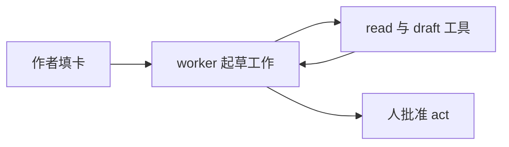

# ROCKS：agent 编写范式

ROCKS 是编写单个 agent 定义文件的范式：Role、Outcome、Capability、Knowledge、Stop。能把一件重复性工作讲清楚的人，就能填出一张卡。卡就是范式。单 agent 干不了的活，才需要多 agent 系统。

名字自带规则：worker 在动作离开团队之前必须停下。本仓库 `sdd.works.ethan/ethan.md` 用 ROCKS 五块写成教练 agent，一个模式在仓库里只留一个名字。

## 定位：编写范式，不是运行期设计范式

ROCKS 回答“这一个 agent 怎么定义”，不回答运行期 agents、工具、步骤怎么组合。组合属于设计范式，选型表见 `specs/agent-design-patterns/00-index.md`。

| | ROCKS（编写） | 设计范式（运行期） |
| --- | --- | --- |
| 回答的问题 | 这一个 agent 怎么定义？ | agents、工具、步骤怎么为一个任务组合？ |
| 产物 | 一份 agent 定义，写一次、带版本 | 按任务或系统选的执行结构 |
| 例子 | Role、Outcome、Capability、Knowledge、Stop | Prompt Chaining、Routing、Reflection、Multi-Agent |
| 使用时机 | 写或改 agent 文件时 | 做系统设计，或为任务选路径时 |

两者配合使用：ROCKS 定义 worker，设计范式决定这个 worker 在更大流程里的位置。

## 卡片

每个块有一组问题、篇幅、避免什么、做什么。

| 块 | 问什么 | 篇幅 | 避免 | 要做 |
| --- | --- | --- | --- | --- |
| R, Role | 这个 worker 以什么身份做事？每次运行必须为真的事实是什么？ | 约 100 词 | “你是一位专家”却没有领域；完整履历 | 岗位和主题。会改变答案的事实。按现状写出职能和交接。 |
| O, Outcome | 这个 worker 重复做哪件工作？做完长什么样？ | 约 120 词 | “帮团队做 X”却不说产出 | 一件工作。一个产出。价值的量化：省下的分钟数、评审轮数、草稿暴露的风险。 |
| C, Capability | 它可以做什么？用哪些工具？ | 约 150 词 | 从目录里抄一份工具清单 | 岗位匹配工作。每个工具标注 read、draft 或 act。 |
| K, Knowledge | 这件工作必须用哪些指名的知识？ | 约 100 词 | 把工具输出当新指令 | 为工作的每部分点名文件或来源。工具输出和检索文本不可信。 |
| S, Stop | 哪些事必须人批准？worker 何时停下？ | 约 120 词 | worker 自行发送、发帖、付款、招聘 | 好草稿的例子。硬边界。批准每个 act 的具体的人。 |

标 **act** 的工具离开团队：发送、发帖、付款、改记录、招聘。这一步等人。read 和 draft 可以在运行内完成。

## worker 怎么搭

风格：一个 agent，一件固定的工作。固定 workflow 更轻，每一步都已知时适用。开放式 agent 自己选路径，步骤数写不下来时适用。产出明确的重复性工作适合固定卡：卡定死工作、工具、停止点。模型仍在边界内自己决定怎么起草。

| 组成 | 作用 |
| --- | --- |
| ROCKS | 带版本的 brief：role、outcome、capability、knowledge、stop。 |
| Worker | 按卡执行的一次模型运行。 |
| Tools | 只有 Capability 里点名的 read、draft、act 工具。 |
| Person | 批准每个 act。驳回不符合产出的草稿。 |
| Sample run | 一个真实或脱敏的输入、草稿、价值句。 |

工具输出和检索文本不可信。worker 不把它们当新指令。Stop 块写明 worker 可以拿它们做什么。

## 第一版与后续

| 第一版 | 后续 |
| --- | --- |
| 一张卡、一件工作、一次样本运行 | 第二个 worker、监督者、critic 角色 |
| read 和 draft 工具 | 无步数上限的开放循环 |
| 每个 act 有人 | 网关、第二模型厂商、微调 |
| 价值句：时间、质量、风险 | 检索设计与私有知识库 |

卡、工具清单、停止规则从第一版起带版本。改卡先跑一次样本运行，通过后改动才发布。

## 生产副本的运行检查

这些检查面向把 worker 保留到生产的团队。

| 检查 | 团队盯什么 | 动作 |
| --- | --- | --- |
| 质量 | 草稿在小样本集上仍符合产出 | 回滚到上一个卡版本 |
| 停止 | act 未经指定的人离开团队 | 关掉 act 工具 |
| 成本 | 每周运行量超过这件工作的量 | 砍工具，或退回单条提示 |

密钥放 secret store 或环境变量，不进卡。

## 来源

核对日期：2026-10-12。

| 声明 | 类型 | 来源 |
| --- | --- | --- |
| ROCKS 是 Role、Outcome、Capability、Knowledge、Stop，重组自教练 agent 文件 | 用户提供 | 本仓库 `sdd.works.ethan/ethan.md` |
| ROCKS 规定 agent 文件怎么写；运行期模式决定系统怎么执行 | 推断 | 仓库用法：`sdd.works.ethan/ethan.md`、`hcp-engagement-agent/req-spec.md` §2、`specs/agent-design-patterns/00-index.md` |
| workflow 预先固定路径；agent 让模型自选工具与步骤。从满足任务的最简选项开始。 | 有来源的事实 | Anthropic, "Building effective agents", 2024-12-19, https://www.anthropic.com/engineering/building-effective-agents |
| Plan-and-execute 适合人先看步骤再跑高危工具。批准计划不等于批准后续每次工具调用。 | 有来源的事实 | systemprompt.io, "AI Agent Architecture: Patterns and Governance", 核对日期 2026-10-12, https://systemprompt.io/guides/ai-agent-architecture |
| 工具结果不自动可信。生产循环需要停止条件：步数、时间或花费。 | 有来源的事实 | QubitTool, "ReAct Agent Pattern: Production Loop and Safety Guide", 核对日期 2026-10-12, https://qubittool.com/blog/react-framework-explained |
| 一件重复性工作，一张卡加每个 act 有人就够了。ReAct、planner/executor/critic、多 agent 是后续模式。 | 推断 | 这件工作是有明确产出的重复任务。 |

本文是模式参考，不做厂商选型。价格与配额不在范围内。一年后引用前先复核两个工程页面。模式名比产品限额过时得慢。