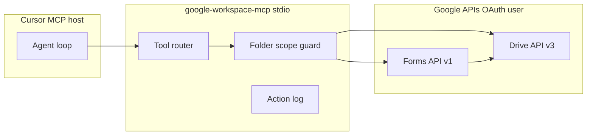

# Spike: Google Drive folder and Google Forms via MCP (full CRUD)

Status: proposal for spike implementation  
Audience: Ethan, agents connecting through Cursor MCP  
Last updated: 2026-10-11

## AI design proposal

### Goal and constraints

Connect **your** Google Drive (scoped to **one folder**) and **Google Forms** from Cursor through **MCP**, with **full CRUD** on files and form structure, plus read access to form responses.

Constraints assumed until you change them:

- Single user (your Google account), not multi-tenant SaaS.
- Cursor is the MCP host (stdio or remote MCP client).
- Secrets stay out of the repo (OAuth client JSON and refresh tokens in local paths or a secret store).
- Agents are untrusted relative to your Drive data (prompt injection risk).


### Style

**Agent** with MCP tools, backed by **Google REST APIs** (Drive v3 + Forms v1).

A fixed **workflow** wrapper is optional later for repeatable jobs (for example nightly export of responses). It is not required for the spike.

Retrieval (RAG over Drive) and fine-tuning are out of scope for this spike.

### Recommended design

Use **one unified local MCP server** (`google-workspace-mcp`) that wraps **Drive API v3** and **Forms API v1** with a shared OAuth session and an optional `GOOGLE_DRIVE_FOLDER_ID` guard on every mutating and listing tool.

Google’s **hosted Drive MCP** (`https://drivemcp.googleapis.com/mcp/v1`) is useful for read/create/search in preview, but its documented tool set does not cover full file lifecycle (no documented delete, trash, or move). Google does **not** publish a hosted Forms MCP. A single custom server avoids split auth, split scope policy, and half-complete CRUD.




| Component                             | Role                                                                                      |
| ------------------------------------- | ----------------------------------------------------------------------------------------- |
| Cursor                                | MCP host; runs the agent loop; stores MCP config only (no refresh token in chat).         |
| `google-workspace-mcp`                | Exposes typed tools; validates args; enforces folder scope; maps errors to stable codes.  |
| Folder scope guard                    | Rejects tool calls that target file IDs outside the configured folder tree (see below).   |
| Drive API v3                          | File CRUD, upload/download, move, trash, permissions, search under folder.                |
| Forms API v1                          | Form structure CRUD via `batchUpdate`; publish settings; response list/get.               |
| OAuth 2.0 (Desktop or Web + loopback) | One consent for combined scopes; refresh token on disk with restrictive file permissions. |


**Folder scoping rule**

- Config: `GOOGLE_DRIVE_FOLDER_ID=<id>`.
- **List/search:** Drive query includes `'FOLDER_ID' in parents` (and optional `trashed=false`).
- **Create/upload/copy:** set `parents: [FOLDER_ID]`.
- **Read/update/delete/move:** after resolving `fileId`, verify the file is the folder itself, is a direct child, or lies under the folder (walk parents or cache path membership). Reject if not in scope.
- **Forms:** treat each form as a Drive file (`mimeType` `application/vnd.google-apps.form`). After `forms.create`, **move** the form file into the folder via Drive if Google created it elsewhere.

**What “full CRUD” means here**


| Resource                                | Create    | Read                     | Update | Delete                                  | Notes                                                                                                  |
| --------------------------------------- | --------- | ------------------------ | ------ | --------------------------------------- | ------------------------------------------------------------------------------------------------------ |
| Drive files in folder                   | Yes       | Yes                      | Yes    | Yes (trash or permanent per tool param) | Includes non-Form files.                                                                               |
| Form structure (title, items, settings) | Yes       | Yes                      | Yes    | Yes                                     | Item CRUD via Forms `batchUpdate`.                                                                     |
| Form publish state                      | Yes       | Yes                      | Yes    | N/A                                     | `setPublishSettings`.                                                                                  |
| Form **responses**                      | No        | Yes                      | No     | No                                      | Forms API exposes **list/get only**; submitting or editing responses is not supported by Google’s API. |
| Delete form file                        | Via Drive | Metadata via Forms/Drive | —      | Via Drive                               | Google documents form deletion through Drive API.                                                      |


### Options compared


| Option                                               | MCP         | Drive CRUD in folder       | Forms CRUD                      | Auth            | Ops load                   | Lock-in                                        |
| ---------------------------------------------------- | ----------- | -------------------------- | ------------------------------- | --------------- | -------------------------- | ---------------------------------------------- |
| **A. Unified custom MCP (recommended)**              | One server  | Full (you implement tools) | Full structure + read responses | One OAuth       | Medium build, low run cost | Low (standard Google APIs)                     |
| **B. Google hosted Drive MCP + community Forms MCP** | Two servers | Partial on Drive side      | Community coverage              | Two OAuth flows | Low build, awkward policy  | Medium (preview Drive MCP + third-party Forms) |
| **C. Community Drive MCP + community Forms MCP**     | Two servers | Often full Drive           | Varies by package               | Two OAuth       | Lowest build               | Medium (npm packages, varying maintenance)     |
| **D. No MCP; direct API scripts**                    | None        | Full                       | Full                            | OAuth           | Lowest for one-off scripts | Low; poor agent ergonomics                     |


Sources for option B Drive limits: [Configure the Drive MCP server](https://developers.google.com/workspace/drive/api/guides/configure-mcp-server) tool list (2026-10-09 UTC doc date). Forms API surface: [Google Forms API REST](https://developers.google.com/forms/api/reference/rest).

### First release and later

**Spike (first release)**

1. TypeScript MCP server using `@modelcontextprotocol/sdk` and `googleapis`.
2. OAuth Desktop client; token file under `~/.config/google-workspace-mcp/` (gitignored).
3. **Drive tools (minimum):** `drive_list`, `drive_search`, `drive_get_metadata`, `drive_read_content`, `drive_create`, `drive_upload`, `drive_update_metadata`, `drive_move`, `drive_copy`, `drive_trash`, `drive_delete`, `drive_export` (Workspace export).
4. **Forms tools (minimum):** `forms_create`, `forms_get`, `forms_batch_update` (thin wrapper with documented request shapes), `forms_set_publish_settings`, `forms_list_responses`, `forms_get_response`, `forms_move_to_folder` (Drive move helper).
5. **Folder guard** on all tools above.
6. **Human approval gate (config flag):** destructive tools (`drive_delete`, `drive_trash`, `forms_batch_update` when `deleteItem` present, permission changes) return `approval_required` unless `GOOGLE_MCP_ALLOW_DESTRUCTIVE=true` in env (default false for spike).
7. Cursor `mcp.json` stdio entry pointing at built `dist/index.js`.

**Production path (defer until spike passes)**

- Streamable HTTP transport behind localhost or internal VPN if multiple hosts need the same server.
- Structured audit log (JSON lines: tool, fileId, formId, timestamp, outcome).
- Optional gateway if you add non-Cursor clients (rate limit, single audit sink).
- Pub/Sub watches for new form responses ([Forms watches API](https://developers.google.com/forms/api/reference/rest)) instead of polling.
- Evaluation gate: fixed script scenarios (create form, add question, move file, trash and restore) before changing tool schemas.

**Interim shortcut (if spike time is tight)**

Wire Cursor to **two** existing servers without building unified MCP first:

- Drive: community server with full scope (for example [ibarcarty/mcp-server-google-drive](https://github.com/ibarcarty/mcp-server-google-drive)) with `https://www.googleapis.com/auth/drive`.
- Forms: [A1-x-Tech/mcp-google-forms](https://github.com/A1-x-Tech/mcp-google-forms) or [naster3/google-forms-mcp](https://github.com/naster3/google-forms-mcp).

You still must implement **folder scoping** yourself (custom wrapper or disciplined prompts). That gap is why unified MCP is the recommended end state.

### Operating design


| Signal                    | Monitor                                           | Rollback / response                                                              |
| ------------------------- | ------------------------------------------------- | -------------------------------------------------------------------------------- |
| OAuth refresh failures    | Log error rate; alert on repeated `invalid_grant` | Re-run consent flow; rotate client if compromised                                |
| Drive quota / rate limits | HTTP 403/429 counts                               | Exponential backoff in server; reduce agent parallelism                          |
| Tool error rate by name   | Per-tool success ratio                            | Disable tool via config map; revert server version                               |
| Destructive actions       | Audit log volume                                  | Turn off `GOOGLE_MCP_ALLOW_DESTRUCTIVE`; restore from Drive trash where possible |
| Prompt injection          | User report; odd share/permission changes         | Require approval for side effects; narrow scopes                                 |


**Human approval (default on for spike)**

- Permanent delete, empty trash, permission grant to new email, publish form accepting responses.
- Agent proposes args; you confirm in Cursor before the server executes (implementation: two-step tool or host-side rule).

**Untrusted context**

- Treat `drive_read_content` and exported Doc text as **untrusted input** in the agent system prompt.
- Do not pass file body text into tools as instructions without summarization boundaries.


### Google Cloud setup (one project)

1. Create or select a GCP project.
2. Enable APIs: **Google Drive API**, **Google Forms API** (do **not** require `drivemcp.googleapis.com` unless you also experiment with Google’s hosted Drive MCP).
3. OAuth consent screen: External or Internal per your account type; add test users if External testing.
4. Scopes (minimum for this design):

  | Scope                                                      | Purpose                                                                                                                        |
  | ---------------------------------------------------------- | ------------------------------------------------------------------------------------------------------------------------------ |
  | `https://www.googleapis.com/auth/drive`                    | Full Drive CRUD within folder guard (spike). Narrow to `drive.file` only if you accept creating files solely through this app. |
  | `https://www.googleapis.com/auth/forms.body`               | Create and edit forms.                                                                                                         |
  | `https://www.googleapis.com/auth/forms.responses.readonly` | List and get responses.                                                                                                        |

   Restricted scopes may require Google verification for production External apps; fine for personal/testing spike.
5. OAuth client: **Desktop app** for local stdio MCP (simplest loopback). Store client secret file outside the repo.

**Cursor MCP config shape (stdio, illustrative)**

```json
{
  "mcpServers": {
    "google-workspace": {
      "command": "node",
      "args": ["/absolute/path/to/google-workspace-mcp/dist/index.js"],
      "env": {
        "GOOGLE_OAUTH_CLIENT_PATH": "/Users/ethanhuang/.config/google-workspace-mcp/client_secret.json",
        "GOOGLE_TOKEN_PATH": "/Users/ethanhuang/.config/google-workspace-mcp/token.json",
        "GOOGLE_DRIVE_FOLDER_ID": "YOUR_FOLDER_ID",
        "GOOGLE_MCP_ALLOW_DESTRUCTIVE": "false"
      }
    }
  }
}
```

Run `node dist/index.js auth` once (or equivalent) to populate the token file.

### Decisions and risks


| Decision                                     | Cost to reverse  | What would change it                                    |
| -------------------------------------------- | ---------------- | ------------------------------------------------------- |
| Unified custom MCP vs dual community servers | Medium           | Spike deadline; you accept weaker folder enforcement    |
| Scope `drive` vs `drive.file`                | Low (re-consent) | Google verification burden; least privilege requirement |
| Folder ID fixed in env vs per-request        | Low              | Multiple folders or shared team drive roots             |
| Destructive tools without approval           | High (data loss) | Personal solo use only; still discouraged               |
| Hosted Google Drive MCP for reads only       | Low              | Google expands official tools to full CRUD              |


| Risk                                      | Mitigation                                                                                  |
| ----------------------------------------- | ------------------------------------------------------------------------------------------- |
| Agent deletes or exfiltrates files        | Folder guard; approval gate; audit log; separate Google account or Shared drive with backup |
| Indirect prompt injection via Doc content | Untrusted context rule; read-only tools for unknown files                                   |
| Forms responses not deletable via API     | Document limitation; export then archive; manual cleanup in UI if needed                    |
| Token theft on laptop                     | File mode 0600 on token path; OS disk encryption                                            |


### Open questions

Answer these before implementation leaves spike:

1. **Folder ID:** What is the exact Drive folder ID (and is it a Shared drive folder)?
2. **Destructive default:** Should permanent delete ever be exposed to the agent, or only trash?
3. **Responses:** Is read-only on submissions enough, or do you need UI/manual workflows for response deletion?
4. **Build vs interim:** Start unified MCP immediately, or wire two community servers for a day-one demo?
5. **Account:** Personal Gmail vs Google Workspace (affects consent screen and verification path).


### Spike acceptance criteria

- [ ] Agent lists only files under the configured folder.
- [ ] Agent uploads a file, renames it, moves it within the folder, trashes it, restores from trash (if tool provided).
- [ ] Agent creates a form, adds a question, publishes, lists responses (read-only).
- [ ] Agent moves the form file into the configured folder.
- [ ] Destructive call without approval returns a clear blocked result.
- [ ] No OAuth secrets in the repository or agent transcripts.


### References

- [Google Drive API v3](https://developers.google.com/workspace/drive/api/reference/rest/v3)
- [Create and manage files (Drive)](https://developers.google.com/workspace/drive/api/guides/create-file)
- [Google Forms API overview](https://developers.google.com/workspace/forms/api/guides)
- [REST Resource: forms](https://developers.google.com/workspace/forms/api/reference/rest/v1/forms) (form deletion via Drive)
- [Configure the Drive MCP server](https://developers.google.com/workspace/drive/api/guides/configure-mcp-server) (official hosted MCP, partial tool set)
- [Google Cloud MCP overview](https://docs.cloud.google.com/mcp/overview)


### Related skills

- Tool transport and server layout: **mcp-expert** when you implement `google-workspace-mcp`.
- This spike does not design RAG over Drive; use **rag-expert** if you add semantic search later.

