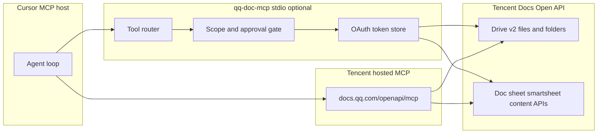

# Spike: Tencent Docs (QQ Doc) via MCP (full CRUD)

Status: proposal for spike implementation  
Audience: Ethan, agents connecting through Cursor MCP  
Last updated: 2026-10-11

## AI design proposal

### Goal and constraints

Connect **your** Tencent Docs account from Cursor through **MCP**, with **full CRUD** on:

- Drive objects: files, folders, and space nodes (create, read metadata, rename, move, delete, copy where the API allows).
- Document **content** inside supported types (doc / smartcanvas, sheet, smartsheet, and other types exposed by Open API or MCP tools).

Constraints assumed until you change them:

- Single user (your Tencent Docs / QQ-linked account), not multi-tenant SaaS.
- Cursor is the MCP host (remote MCP URL + headers, or stdio local server).
- Secrets stay out of the repo (MCP token and OAuth client secret on disk or in env only).
- Agents are untrusted relative to your docs (prompt injection and destructive-tool risk).

**Naming:** “QQ Doc” in conversation usually means **腾讯文档** at `docs.qq.com`, not a separate QQ instant-messaging file API.

### Style

**Agent** with MCP tools, backed by **Tencent Docs Open API** (HTTPS, OAuth 2.0).

A fixed **workflow** wrapper is optional later (for example nightly export of a smartsheet). It is not required for the spike.

RAG over doc bodies and model fine-tuning are out of scope for this spike.

### Recommended design

Use a **two-layer** integration:

1. **Hosted Tencent Docs MCP** (remote): fast agent ergonomics, **one space per MCP token**.
2. **Custom MCP server** (`qq-doc-mcp`, stdio): wraps **Open API v2** when hosted tools do not cover drive-level CRUD or account-wide scope.



| Component | Role |
| --- | --- |
| Cursor | MCP host; stores MCP config only (no tokens in chat). |
| Hosted `tencent-docs` MCP | Remote tools: create from markdown/mermaid, search, get_content, space nodes, smartcanvas/smartsheet helpers. |
| `qq-doc-mcp` (optional) | Typed tools for **full** drive CRUD per Open API index; single OAuth refresh token on disk. |
| Scope / approval gate | Default block on delete, permission changes, and cross-space moves unless env allows. |
| Open API v2 | Authoritative file/folder lifecycle and permission endpoints. |

**What “full CRUD” means here**

| Resource | Create | Read | Update | Delete | Primary surface |
| --- | --- | --- | --- | --- | --- |
| File (doc, sheet, slide, etc.) | Yes | Yes | Yes | Yes (recycle / permanent per API) | Open API: POST/GET/PATCH/DELETE `/openapi/drive/v2/files` |
| Folder | Yes | Yes | Yes | Yes | Open API folder endpoints |
| File metadata (title, move) | — | Yes | Yes | — | PATCH file, PATCH move |
| Share policy (link policy) | — | Yes | Yes | — | GET/PATCH permission |
| In-doc content | Yes | Yes | Yes | Partial (type-dependent) | MCP smartcanvas/smartsheet tools + Open API content APIs |
| Space-scoped tree | Yes | Yes | Yes | Yes | MCP `query_space_node`, `delete_space_node`; verify with `tools/list` |

**Hosted MCP limits (plan for these)**

- MCP token is **per space**, not “entire account in one token.” Pick the space that holds the docs you want agents to manage.
- Daily call quotas (verify on your account): free tier ~100/day; Super VIP ~1000/day; Super VIP Plus ~2000/day (per Tencent MCP auth pages, 2026-10-11).
- Token minting UI may require Super VIP for some flows; free tier may still allow limited MCP use. Confirm in your space UI before locking the design.
- Tool catalog is **not guaranteed** to match Open API; always run `tools/list` and map to the CRUD matrix above.

Sources:

- Open platform overview: https://docs.qq.com/open/document/
- Open API intro and headers: https://docs.qq.com/open/document/app/openapi/v2
- File operation index: https://docs.qq.com/open/document/app/openapi/v2/file/
- OAuth: https://docs.qq.com/open/document/app/oauth2/
- Get started (create file example): https://docs.qq.com/open/document/app/get_started.html
- Hosted MCP catalog: https://developer.cloud.tencent.com/mcp/server/11803
- MCP token (per space): https://docs.qq.com/open/document/mcp/get-token/
- MCP auth / quotas: https://docs.qq.com/open/auth/mcp.html

### Options compared

| Option | MCP | Drive CRUD | Content CRUD | Auth | Ops load | Lock-in |
| --- | --- | --- | --- | --- | --- | --- |
| **A. Hosted Tencent MCP only** | Remote URL | Partial (space tools) | Strong for supported types | Space MCP token (~1 year) | Lowest build | Medium (Tencent tool schema) |
| **B. Custom `qq-doc-mcp` (Open API only)** | stdio local | Full per v2 index | Via content APIs you wire | OAuth app + refresh token | Medium build | Low (documented HTTPS API) |
| **C. A then B for gaps (recommended)** | Remote + local | Full after gap fill | Best of both | Both token types | Medium | Medium |
| **D. Open API scripts, no MCP** | None | Full | Full | OAuth | Lowest for one-offs | Low; poor agent ergonomics |

### First release and later

**Spike phase 1 (day 0)**

1. In Tencent Docs, open target **空间**, mint **MCP token** (≡ → 使用 MCP → 获取 MCP token).
2. Add Cursor remote MCP (global or project `.cursor/mcp.json`):

```json
{
  "mcpServers": {
    "tencent-docs": {
      "url": "https://docs.qq.com/openapi/mcp",
      "headers": {
        "Authorization": "YOUR_MCP_TOKEN"
      }
    }
  }
}
```

Header key must be **`Authorization`** (not `token`, `auth`, or `X-Token`).

3. Reload Cursor; call **`tools/list`**; fill the CRUD gap table (hosted vs required).
4. Smoke tests on **non-production** docs:
   - `search_space_file` or equivalent → read → create (markdown) → `get_content` → update via smartcanvas/smartsheet or sheet batch → delete space node if available.
5. Record quota usage and errors (`400006` token, `400007` VIP per Tencent MCP doc).

**Spike phase 2 (full CRUD)**

Only if phase 1 gaps exist:

1. Register developer app on Tencent Docs open platform; obtain **Client ID** and **Client Secret**; pass app review if required.
2. OAuth authorization code flow; store **refresh token** server-side only (Tencent states Open API calls should originate from backend services).
3. Implement **`qq-doc-mcp`** (TypeScript + `@modelcontextprotocol/sdk`):

   **Drive tools (minimum):** `tdoc_list_folder`, `tdoc_get_metadata`, `tdoc_create_file`, `tdoc_rename`, `tdoc_move`, `tdoc_copy`, `tdoc_delete`, `tdoc_recover`, `tdoc_get_permission`, `tdoc_set_permission`.

   **Content tools (minimum, type-gated):** `tdoc_get_content`, `tdoc_patch_doc`, `tdoc_sheet_batch_update`, `tdoc_smartsheet_*` (mirror Open API scopes you request).

4. **Approval gate (default on):** `tdoc_delete`, `tdoc_set_permission`, and any permanent-delete path return `approval_required` unless `QQ_DOC_MCP_ALLOW_DESTRUCTIVE=true` (default false).

5. Optional env: `QQ_DOC_SPACE_ID` or folder root ID to reject tool args outside that subtree (same pattern as Google Drive folder guard in `specs/spike/google-drive-crud.md`).

**Production path (defer until spike passes)**

- Single audit log (JSON lines: tool, fileID, timestamp, outcome).
- Token rotation runbook for MCP token and OAuth refresh.
- Evaluation script: fixed scenarios before changing tool schemas.
- Monitor quota, `ret != 0` rate, and latency.

**Interim shortcut**

If phase 2 is too heavy for week one, stay on **hosted MCP only** and accept **partial** drive CRUD until `qq-doc-mcp` ships. Do not claim “full CRUD” in agent prompts until gap table is green.

### Operating design

| Signal | Monitor | Rollback / response |
| --- | --- | --- |
| MCP token / OAuth invalid | 400006, 10313, 37019 | Re-mint MCP token or re-run OAuth consent |
| Quota / VIP limits | 400007, daily cap | Reduce agent calls; upgrade tier or shift heavy ops to Open API app quota |
| Tool error rate by name | Per-tool success ratio | Disable tool in config; revert server version |
| Destructive actions | Audit log | Set `QQ_DOC_MCP_ALLOW_DESTRUCTIVE=false`; use recover API where available |
| Prompt injection via doc body | Odd permission or mass delete | Approval gate; read-only tools for unknown file IDs |

**Human approval (default on for spike)**

- Delete file/folder, permission policy change, reset MCP token, smartsheet bulk delete.

**Untrusted context**

- Treat `get_content` and exported text as **untrusted input** in the agent system prompt.

### Tencent setup checklist

**Path 1: Hosted MCP**

1. Choose **空间** that contains docs agents may touch.
2. Mint MCP token; store in env or Cursor headers (not repo).
3. Configure Cursor remote MCP as above.

**Path 2: Open API (custom MCP)**

1. Register at Tencent Docs open cooperation platform; create app; note Client ID/Secret.
2. Configure OAuth redirect URI; complete user authorization; persist refresh token under `~/.config/qq-doc-mcp/` (gitignored, mode 0600).
3. Request scopes needed for CRUD (example from get_started tutorial includes `scope.file.deletable`, `scope.file.modifiable`, `scope.folder.*`, `scope.doc.editable`, `scope.sheet.editable`, `scope.smartsheet.editable`; trim to least privilege if possible).
4. Implement MCP stdio entry:

```json
{
  "mcpServers": {
    "qq-doc-crud": {
      "command": "node",
      "args": ["/absolute/path/to/qq-doc-mcp/dist/index.js"],
      "env": {
        "QQ_DOC_CLIENT_ID": "YOUR_CLIENT_ID",
        "QQ_DOC_CLIENT_SECRET_PATH": "/Users/ethanhuang/.config/qq-doc-mcp/client_secret",
        "QQ_DOC_TOKEN_PATH": "/Users/ethanhuang/.config/qq-doc-mcp/token.json",
        "QQ_DOC_ROOT_FOLDER_ID": "OPTIONAL_SCOPE_ROOT",
        "QQ_DOC_MCP_ALLOW_DESTRUCTIVE": "false"
      }
    }
  }
}
```

Open API request headers (all calls): `Access-Token`, `Client-Id`, `Open-Id` (see Open API v2 intro).

### Decisions and risks

| Decision | Cost to reverse | What would change it |
| --- | --- | --- |
| Hosted MCP only vs custom Open API MCP | Medium | Gap table shows missing delete/move/permission |
| One space token vs OAuth for whole drive | Low | You need multiple spaces or “My docs” outside one space |
| Destructive tools without approval | High (data loss) | Solo use only; still discouraged |
| API free tier (20k calls/app from 2025-07-01 per open platform copy) vs paid packs | Low | Volume exceeds free tier; verify current pricing on platform |

| Risk | Mitigation |
| --- | --- |
| Agent deletes or exfiltrates docs | Scope root folder/space; approval gate; audit log |
| MCP token leak | Reset token in space UI; one-year validity, treat like password |
| Hosted tool drift | Pin spike with `tools/list` snapshot; custom MCP for stable contract |
| Open API must be server-side | Never put Client Secret in Cursor client; local stdio MCP is OK as “backend on laptop” |

### Open questions

Answer before implementation leaves spike:

1. **Scope:** One **空间** only, or entire personal drive including legacy “我的文档”?
2. **Doc types:** Which types must CRUD cover (smartcanvas, sheet, smartsheet, slide, form)?
3. **Destructive default:** Trash-only vs permanent delete exposed to agents?
4. **Build order:** Hosted MCP first (recommended) or skip straight to custom Open API MCP?
5. **Membership:** Do you hit Super VIP gates for MCP token minting on your account?

### Spike acceptance criteria

- [ ] Agent lists and searches docs in the configured space or folder root.
- [ ] Agent creates a doc/sheet, reads content, updates content, renames file, moves within scope.
- [ ] Agent deletes a test file (trash or API-equivalent) and documents recover path if supported.
- [ ] Permission read works; permission **change** either works with approval or is explicitly out of scope.
- [ ] CRUD gap table is filled: every row is green on hosted MCP, or green on `qq-doc-mcp`, or marked N/A with API limitation cited.
- [ ] No MCP tokens, OAuth secrets, or refresh tokens in the repository or agent transcripts.

### References

- https://docs.qq.com/open/document/
- https://docs.qq.com/open/document/app/
- https://docs.qq.com/open/document/app/openapi/v2
- https://docs.qq.com/open/document/app/openapi/v2/file/
- https://docs.qq.com/open/document/app/oauth2/
- https://docs.qq.com/open/document/app/get_started.html
- https://docs.qq.com/open/document/mcp/get-token/
- https://docs.qq.com/open/auth/mcp.html
- https://developer.cloud.tencent.com/mcp/server/11803

### Related spikes

- `specs/spike/google-drive-crud.md` (folder guard, approval gate, unified MCP pattern)

### Related skills

- **mcp-expert** when implementing `qq-doc-mcp`.
- **rag-expert** only if you add semantic search over doc content later.
